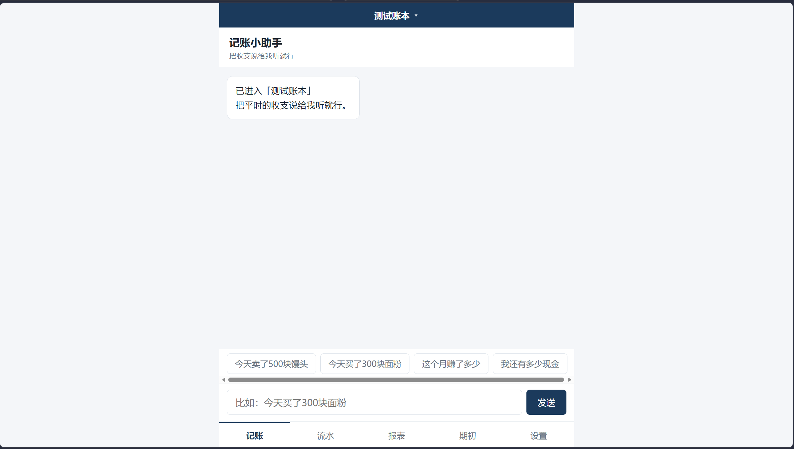
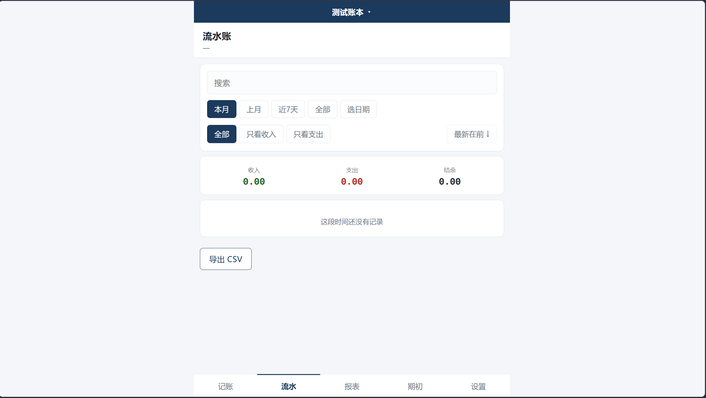
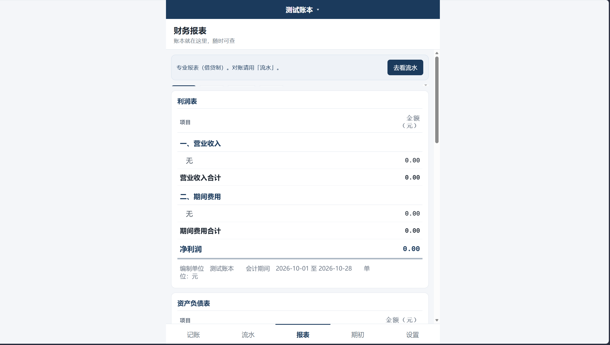
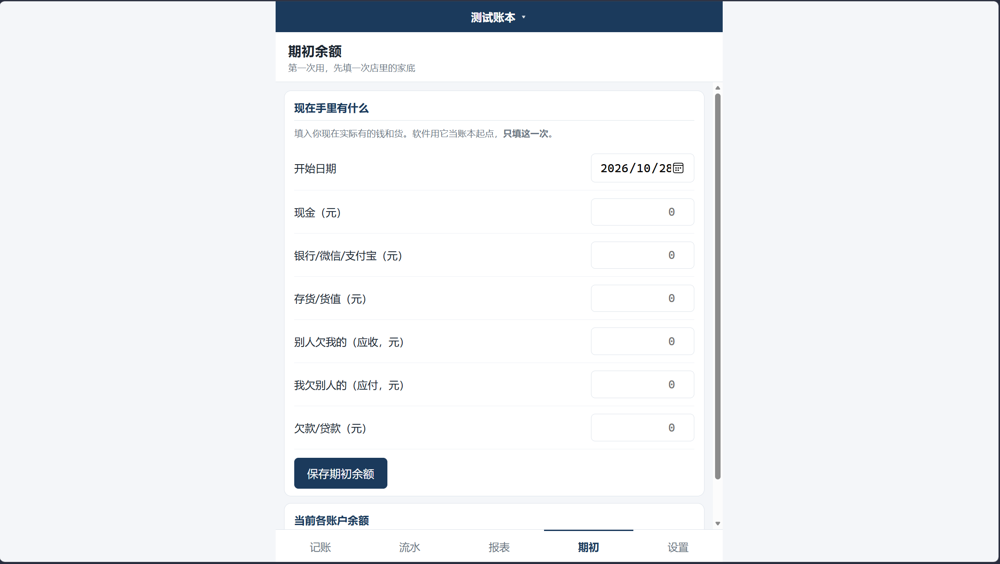
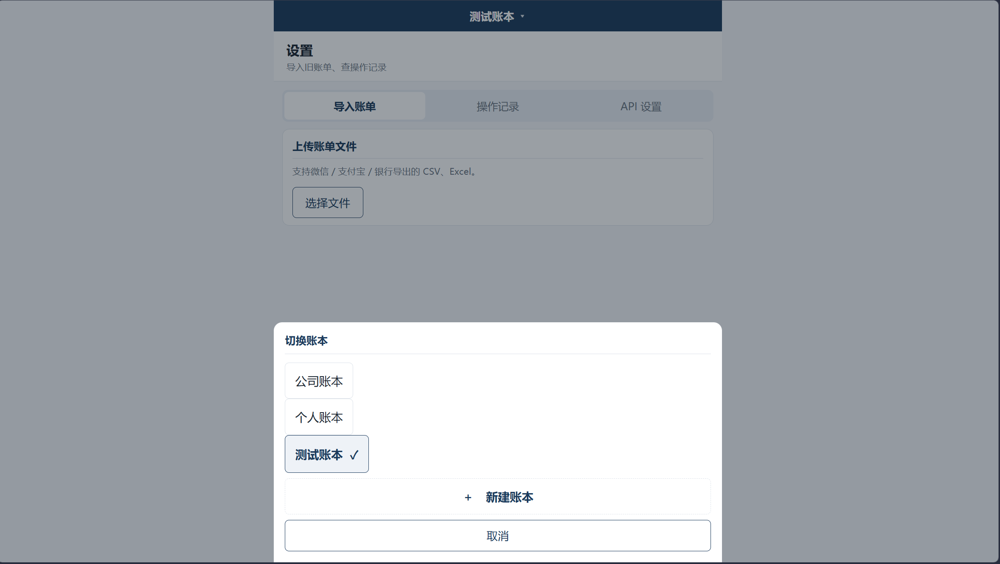

# 「一句话记账」

面向小微商户的自然语言 AI 复式记账助手

> 说一句口语，得到一套能交给会计的专业账。
> **AI 只产出草稿，永不直接落账。**

---

## 一、这个项目解决什么问题

个体户、夫妻店和小微商户普遍不会专业记账：日常靠纸笔或微信账单，月底说不清赚了多少，把账交给会计时又对不上。现有记账软件要求用户先懂借贷复式记账，对中老年店主尤其不友好。

本项目让店主用一句自然语言完成专业复式记账：

```
用户：今天卖了 580 块门锁
系统：10月11日 门锁 580.00 元
        现金 ← 销售收入
      记这笔对吗？【确认】或直接修改
用户：确认
系统：记好啦。现金余额 12,340.00 元。
```

底层是真正的 Beancount 复式记账，可生成利润表、资产负债表、试算平衡表，账本可直接交给会计。

---

## 界面预览

<table>
  <tr>
    <td width="50%"><br><sub>对话记账：说一句就出确认卡片，确认后才落账</sub></td>
    <td width="50%"><br><sub>流水账：按天分组，可搜索、筛选、导出 CSV</sub></td>
  </tr>
  <tr>
    <td><br><sub>财务报表：利润表 / 资产负债表 / 试算平衡 / 明细账</sub></td>
    <td><br><sub>期初余额：只填一次的家底，让账本和现实对齐</sub></td>
  </tr>
  <tr>
    <td colspan="2"><br><sub>设置：账单导入、操作记录、API 配置，以及公司 / 个人 / 测试多账本切换</sub></td>
  </tr>
</table>

---

## 二、快速开始（Windows）

### 环境要求

- Windows 10/11
- Python 3.11+（开发环境为 3.12.9）

### 三步启动

```cmd
cd /d <解压目录>\Competition

REM 1) 创建虚拟环境并安装依赖（首次执行，约 1–2 分钟）
python -m venv .venv
.venv\Scripts\python.exe -m pip install -r backend\requirements.txt

REM 2) 配置模型（见下一节）
copy backend\.env.example backend\.env
REM 编辑 backend\.env，填入接口地址、API Key、模型名

REM 3) 启动
.venv\Scripts\python.exe -m uvicorn app.main:app --host 127.0.0.1 --port 8000 --app-dir backend
```

浏览器打开 **http://127.0.0.1:8000**。

> 也可以直接双击 `start.bat`，它会自动检查环境并启动。

### 配置模型

编辑 `backend/.env`：

```ini
DEEPSEEK_BASE_URL=https://<平台接口地址>/v1
DEEPSEEK_API_KEY=<你的 Key>
MODEL=<模型名>
```

项目使用 **OpenAI 兼容接口**，更换模型平台只需修改这三行，代码无需改动。
启动后可在页面 **设置 → API 设置** 中查看和修改，并点「测试连接」验证。

---

## 三、三分钟演示流程

1. 打开页面 → 选择「测试账本」
2. 对话页依次输入：
   - `我开店投了3万现金` → 确认
   - `今天买了300块面粉` → 确认
   - `今天卖了500块馒头` → 确认
   - `这个月房租交了3000` → 确认
   - `不对，是3500` → 确认（演示修改草稿）
3. 切到「流水」页：按天分组的收支明细，可搜索、筛选、导出 CSV
4. 切到「报表」页：利润表、资产负债表（带恒等式校验）、试算平衡、明细账
5. 报表页底部「月末成本结转」：填入仓库实际盘点数 → 试算 → 确认结转
6. 切到「设置 → 操作记录」：查看每笔账对应的用户原话与修改记录

也可以直接运行脚本，自动跑完整流程：

```cmd
.venv\Scripts\python.exe scripts\demo_simulation.py
.venv\Scripts\python.exe scripts\stress_test.py
```

---

## 四、项目结构

```
Competition/
├── backend/
│   ├── app/
│   │   ├── main.py            FastAPI 入口（22 个 API）
│   │   ├── config.py          配置（.env / 令牌文件）
│   │   ├── core/
│   │   │   ├── beancount_engine.py  账本读写、校验、报表、成本结转
│   │   │   ├── accounts.py          18 个科目的受控词表
│   │   │   ├── validator.py         中文金额/日期确定性解析
│   │   │   ├── memory.py            SQLite（聊天/映射/草稿/审计）
│   │   │   ├── importer.py          CSV/Excel 账单导入
│   │   │   └── books.py             多账本注册表
│   │   ├── flows/             对话状态机、记账、查询、纠错
│   │   └── llm/               模型客户端、提示词、结构化模型
│   ├── tests/                 99 个自动化测试
│   └── requirements.txt
├── frontend/                  原生 HTML/CSS/JS（移动端优先）
├── scripts/                   演示、压力测试、平台自检、打包
├── assets/                    界面截图
└── start.bat
```

---

## 五、核心设计：四道关卡

```
用户口语
   │
   ▼
① LLM 结构化抽取          ← 唯一不可信的一层，只产出草稿
   │
   ▼
② 确定性硬校验            ← Pydantic Schema + 中文金额/日期解析
   │
   ▼
③ 人工确认闸门            ← 没有"确认"绝不落账
   │
   ▼
④ 事务性落账              ← 写前备份 → 写 → 重载校验 → 失败整批回滚
```

配套机制：

| 机制 | 作用 |
|---|---|
| **复式借贷平衡** | 每笔分录自动校验，账本不可能被写坏 |
| **审计溯源** | 每笔分录带 `^link`，可反查用户原话、修改前后 |
| **多账本隔离** | 公司 / 个人 / 测试账本，账本与数据库完全独立 |
| **定期盘存结转** | 月末盘点倒推销售成本，解决利润虚高 |
| **映射记忆** | 用户确认一次「面粉→存货」，下次自动沿用 |

---

## 六、测试与验证

```cmd
cd backend
..\.venv\Scripts\python.exe -m pytest tests/ -q
```

- **99 个自动化测试**全部通过
- 覆盖：金额/日期解析、借贷平衡与回滚、记账状态机、导入、多账本隔离、审计溯源、成本结转
- 压力测试：五金店 3 个月 340 笔流水，试算平衡与资产负债表恒等式全部通过

---

## 七、数据与隐私

- 账本保存为**纯文本 `.bean`**，可直接阅读、备份、交给会计
- 聊天记录、分类映射、草稿、审计记录存本地 SQLite
- API Key 仅保存在本机 `backend/.env`，不会上传
- 发布包中**不包含任何密钥或真实账本数据**

---

## 八、已知限制

| 限制 | 说明 |
|---|---|
| 单用户、无登录 | 面向个人店铺本地使用 |
| 语音输入未实现 | 当前为文字对话，语音为后续方向 |
| 多模态未接入 | 暂不支持拍照识别小票 |
| 查询为模板式 | 预置报表模板 + Python 聚合，未使用工具调用 |
| 存货采用定期盘存 | 非逐件永续盘存，适合小店 |

---

## 九、文档

设计文档与使用指南随参赛材料一并提交，不包含在本仓库中。

---

## 十、同类项目对比

[EasyAccounts](https://github.com/QingHeYang/EasyAccounts) 是一款成熟的开源中文记账软件（2021 年至今），支持 Docker 部署，内置智能助手「小易」，通过 Tool Call 提供账户查询、记账、改账、报表导出等工具，并支持 MCP 与图片识别。它是本项目重要的参考对象。

> 说明：本项目未使用 EasyAccounts 的任何代码，以下仅作同类产品思路对比。

### 定位差异

| 维度 | EasyAccounts / 小易 | 本项目「一句话记账」 |
|---|---|---|
| 目标用户 | 个人 / 家庭 | 个体户 / 小微商户 |
| 账务内核 | 账户 + 收支 + 分类的流水记录 | 标准复式记账（Beancount），借贷平衡自动校验 |
| AI 的角色 | 通过 Tool Call 直接操作数据 | 只产出结构化草稿，人工确认后才落账 |
| 可审计性 | 备注标记 `#AI记账` | `^link` 双向溯源：用户原话 ↔ 账本分录 |
| 报表 | 收支统计、分类分析 | 利润表 / 资产负债表 / 试算平衡表 / 明细账 |
| 数据形态 | 关系型数据库 | 纯文本 `.bean`，可阅读、可 diff、可直接交给会计 |
| AI 能力侧重 | Agent 多工具编排、MCP、图片识别 | 结构化抽取 + 确定性校验 + 确认闸门 |
| 交互门槛 | 对话式 | 双视图：会计看三表，店主看流水 |
| 部署 | Docker Compose | 本地 Python / 单文件 exe |

### 两种取舍

这不是"谁更强"的比较，而是**场景不同带来的设计取舍**：

- **EasyAccounts** 面向"自己看得懂账"的个人和家庭，AI 直接记账更省事，Agent 编排、MCP 生态和多模态识别也更成熟；
- **本项目**面向"账要能交给会计、要能报税"的个体户，因此把 **AI 不能直接落账** 和 **每一笔可追溯** 作为硬约束，在会计口径、数据可审计和低门槛交互上做了不同的探索。

两者可以互补：Agent 工具调用适合**查询类**场景，抽取式 + 确认闸门适合**写入类**场景。
